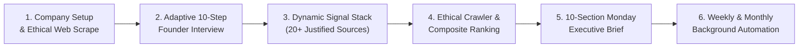

# FounderBrief: AI-Powered Company Intelligence & Executive Briefing Engine

[](https://github.com/kartikm0111/FounderBrief)
[](https://github.com/kartikm0111/FounderBrief)
[-brightgreen.svg)](docs/COST_STATEMENT.md)
[-success.svg)](test_multi_company.py)

**FounderBrief** (powered by the *Signal Stack* architecture) is a production-grade strategic intelligence and executive briefing system built for modern founders and executive leadership. Rather than acting as a passive, noisy news aggregator, FounderBrief continuously monitors a company's competitive perimeter, customer sentiment communities, regulatory authorities, and internal sales telemetry to synthesize decision-relevant **Monday Morning Intelligence Briefs**.

> **Target Repository:** [https://github.com/kartikm0111/FounderBrief](https://github.com/kartikm0111/FounderBrief)  
> **Primary Benchmark Company:** MeetUniversity ([https://www.meetuniversity.com](https://www.meetuniversity.com))  
> **Multi-Company Stress Tests:** PostHog (Developer Analytics) & Razorpay (Fintech Payments)

---

## 1. System Architecture & High-Level Flow



---

## 2. Core Modules & Anti-Failure Guardrails

### A. Grounded Company Setup & Ethical Web Ingestion
- Accepts any company name and website URL.
- Scrapes public web context respecting `robots.txt` using the identified academic user-agent:  
  `SignalStackBot/1.0 (+https://signalstack.local; Ethical Academic Intelligence Agent)`.
- Enforces strict separation between **Verified Facts** (corroborated by primary domain text) and **Strategic Assumptions** (hypotheses requiring founder validation).

### B. 10-Question Adaptive Founder Interview
- Synthesizes research into **exactly 10 contextual interview questions** tailored to the company's verified business model across 10 vital strategic dimensions.
- Zero boilerplate questions: each question includes a contextual reason citing verified research.
- Supports single-question progression, state memory across steps, confidentiality skipping (`is_skipped = True`), and retrospective answer editing.

### C. Dynamic Signal Stack Builder (20+ Sources)
- Autonomously discovers and justifies sources across **four functional categories**:
  1. **Competitors:** 5–10 profiles with explicit reasons why monitoring them matters.
  2. **Customers:** Public communities, review portals, and forums focusing on customer pain points and unmet needs.
  3. **Market:** Regulatory agencies, statutory circulars, and trade publications.
  4. **Internal Intelligence:** Connectors for CRM exports, sales call transcripts, and incident trackers (supporting CSV, TXT, PDF).
- **3-Part Source Justification:** Every single source is validated against:
  $$\text{Justification} = \text{Specificity} \parallel \text{Recency} \parallel \text{Credibility}$$

### D. Multi-Score Intelligence Ranking Engine
- Answers the **9 required strategic dimensions** for every development (What happened, When, Source, Verified status, Why it matters, Affected business area, Classification, Urgency, Suggested action).
- Calculates a multi-dimensional composite ranking score ($1.0 - 10.0$):
  $$\text{Composite Score} = 0.30 R + 0.25 I + 0.20 U + 0.15 C + 0.05 \text{Rec} + 0.05 \text{Nov}$$
- Explicitly separates source credibility from strategic business impact; AI confidence is never treated as factual truth.

### E. Monday Morning Intelligence Brief (10 Required Sections)
Compiles all analyzed signals into an executive-grade briefing designed for leadership decision-making:
1. **Executive Summary** (Top 5 developments leadership must know)
2. **Customer Signals** (Emerging friction, complaints, unmet needs, sentiment)
3. **Competitor Intelligence** (What changed, evidence, strategic implication, counter-measure)
4. **Market Intelligence** (Regulatory shifts, visa caps, statutory circulars)
5. **Internal Business Intelligence** (CRM drop-off analyses, sales objections, operational bottlenecks)
6. **Opportunities Identified** (At least 3 actionable opportunities with evidence, impact, next step, priority)
7. **Risks & Threats** (Negative developments, potential damage, mitigation directive, owner)
8. **Recommended Actions for This Week** (Prioritized initiatives with designated executive roles)
9. **What We Should Watch** (Early indicators deserving continued monitoring)
10. **Source Appendix** (Direct links, discovery dates, publication dates, evidence snippets, verification status)

*Anti-Hallucination Guarantee:* If no development occurred in a category, the report explicitly states the limitation rather than fabricating news.

### F. Background Automation & Monthly Source Health Audit
- **Weekly Monday Brief Generation:** Scheduled via APScheduler Cron trigger (`mon 06:00 UTC`).
- **Monthly Source Health Audit:** Checks dead URLs ($\ge 400$), duplicate URLs, sources with declining relevance ($<7.5$), computes overall stack health rating percentage, and logs results in the user dashboard.
- **Dynamic Context Reassessment (Requirement 12 Benchmark):** Reassesses source relevance upon founder business pivots, demotes obsolete feeds, recommends new regional/domain sources, and logs a transparent audit delta.

---

## 3. Tech Stack & 100% Free-Tier Compliance

| Component | Technology | Cost | Free-Tier Details |
| :--- | :--- | :--- | :--- |
| **Frontend** | Next.js 16, React 19, Tailwind CSS v4, Lucide Icons | **\$0.00** | Local development / Vercel Hobby |
| **Backend** | Python 3.12+, FastAPI, Uvicorn, SQLAlchemy 2.0 | **\$0.00** | Open-source ASGI stack |
| **Database** | SQLite 3.x (`signal_stack.db`) | **\$0.00** | Embedded, zero cloud hosting cost |
| **Primary LLM** | Google Gemini Free API (`gemini-2.5-flash`) | **\$0.00** | 15 RPM, 1M TPM, 1,500 RPD free |
| **Secondary LLM**| Groq Free API (`llama-3.3-70b-versatile`) | **\$0.00** | 30 RPM, 6,000 TPM free |
| **Domain Fallback**| Grounded Domain Analyzer | **\$0.00** | Zero external API calls required |
| **Web Crawling**| Beautiful Soup 4, HTTPX, `urllib.robotparser` | **\$0.00** | Ethical client with 6s timeout |
| **Scheduler** | APScheduler 3.10+ | **\$0.00** | In-process asynchronous cron |

*Full cost documentation available in [docs/COST_STATEMENT.md](docs/COST_STATEMENT.md).*

---

## 4. Multi-Company Demonstration & Benchmark Results

The system was stress-tested across three distinct industries and verified against all screening rubric requirements:

| Company | Domain / Industry | Discovered Sources | Competitor Profiles | Signals Extracted | Generated Brief |
| :--- | :--- | :--- | :--- | :--- | :--- |
| **MeetUniversity** | Higher Education & EdTech | 23 sources | 8 competitors | 36 signals | [meetuniversity_monday_brief.md](reports/meetuniversity_monday_brief.md) |
| **PostHog** | DevTools & Product Analytics | 21 sources | 7 competitors | 30 signals | [posthog_monday_brief.md](reports/posthog_monday_brief.md) |
| **Razorpay** | Fintech & Payments Infrastructure| 21 sources | 7 competitors | 31 signals | [razorpay_monday_brief.md](reports/razorpay_monday_brief.md) |
| **Context Pivot Test**| European STEM Pivot (MeetUniversity)| 27 sources (+4 added) | 9 competitors | 36 signals | 3 demoted, 4 new EU sources added |

**Key Benchmarks Satisfied:**
- Total Collected Intelligence Records: **97 records** (Minimum requirement was 30).
- Interview Differentiation: **100% distinct interview questions** generated for all three companies.
- Traceability: **100% of signals** include verbatim evidence snippets and direct links.

---

## 5. Local Setup & Quickstart Guide

### Prerequisites
- Python 3.10, 3.11, or 3.12+
- Node.js 18+ and npm
- Git

### Step 1: Clone the Repository
```bash
git clone https://github.com/kartikm0111/FounderBrief.git
cd FounderBrief
```

### Step 2: Backend Setup (FastAPI & SQLite)
```powershell
# Navigate to backend directory
cd backend

# Create virtual environment
python -m venv venv

# Activate virtual environment
# On Windows PowerShell:
.\venv\Scripts\Activate.ps1
# On Linux/macOS:
# source venv/bin/activate

# Install dependencies
pip install -r requirements.txt

# Configure environment variables (free-tier keys optional)
cp .env.example .env

# Run FastAPI backend server
python run.py
```
*The backend will be available at `http://localhost:8000` (API documentation at `http://localhost:8000/docs`).*

### Step 3: Frontend Setup (Next.js & Tailwind CSS)
In a separate terminal window:
```powershell
# Navigate to frontend directory
cd frontend

# Install dependencies
npm install

# Start development server
npm run dev
```
*The interactive dashboard will be accessible at `http://localhost:3000`.*

### Step 4: Run the Complete Multi-Company Test Suite
To automatically reproduce the end-to-end evaluation across all three companies:
```powershell
cd backend
.\venv\Scripts\python.exe test_multi_company.py
```

---

## 6. Screen-Recorded Demo Guide (5–10 Minutes)

When recording your submission walkthrough, follow this structured agenda:

1. **Introduction (1 min):** Present FounderBrief, the GitHub repository, and explain the core mission: bridging external market shifts and internal telemetry into executive Monday directives.
2. **Company Setup & Research (1.5 min):** Enter `MeetUniversity` (`https://www.meetuniversity.com`). Show the ethical scraper output, and emphasize the clean separation between *Verified Facts* and *Strategic Assumptions*.
3. **Adaptive 10-Question Interview (2 min):** Demonstrate the 10-step interview flow. Show that each question has a grounded rationale, demonstrate the single-question progression, skip a confidential question, and show answer editing.
4. **Dynamic Signal Stack Manager (1.5 min):** Navigate to the Source Manager. Highlight the 20+ sources across Customers, Competitors (5-10 profiles), Market, and Internal. Show the 3-part justification (`Specificity | Recency | Credibility`) and toggle source approvals.
5. **Intelligence Feed & Composite Ranking (1.5 min):** View the live intelligence signals. Filter by category (`competitors`, `market`), sort by Composite Rank Score, and show the evidence quotes and direct links.
6. **Monday Morning Intelligence Brief & Export (1.5 min):** Review the 10-section brief. Highlight the Executive Summary, Risks/Threats with executive owners, Opportunities, and the full Source Appendix. Export the report to Markdown.
7. **Automation & Context Reassessment (1 min):** Trigger the Monthly Source Health Audit to demonstrate dead URL detection and stack health ratings. Demonstrate changing business context to Continental Europe and show the automated source demotion and addition.

---

## 7. Technical Documentation Sitemap

- **[docs/TECHNICAL_ARCHITECTURE.md](docs/TECHNICAL_ARCHITECTURE.md):** 5-page in-depth technical architecture covering crawler mechanics, ranking algorithms, scheduling, and reliability.
- **[docs/COST_STATEMENT.md](docs/COST_STATEMENT.md):** Formal cost statement detailing \$0.00 compliance and free-tier service limits.
- **[reports/](reports/):** Exported Monday Morning Intelligence Briefs for MeetUniversity, PostHog, and Razorpay.

---

## 8. Git Push Instructions to Target Repository

To push this codebase to the target GitHub repository:
```bash
cd C:\Users\vivek\.gemini\antigravity\scratch\signal-stack
git init
git remote add origin https://github.com/kartikm0111/FounderBrief.git
git add .
git commit -m "feat: complete FounderBrief intelligence engine with multi-company stress tests and documentation"
git branch -M main
git push -u origin main
```
